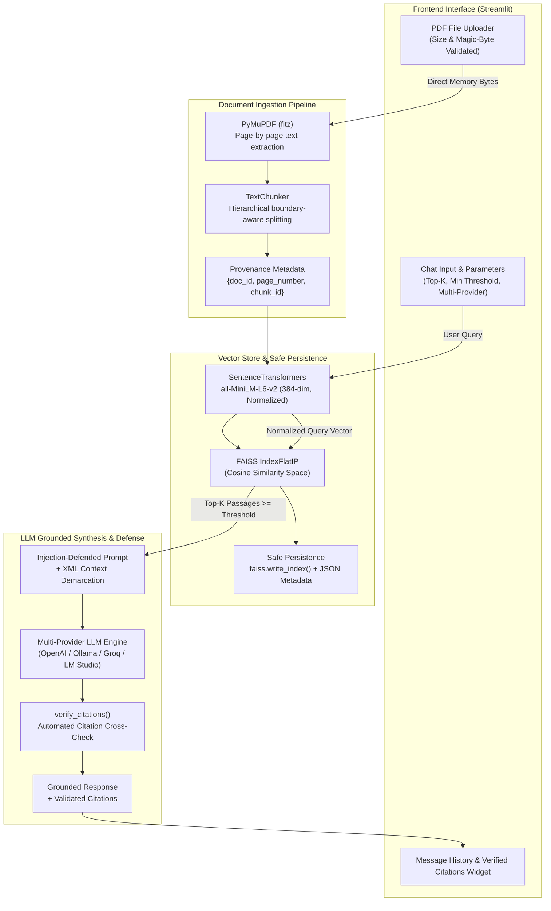

# 📄 RAG BOT — High-Precision Conversational PDF Assistant

[]()
[]()
[-blue.svg)]()
[]()
[]()
[]()
[]()

A well-tested, modular **Retrieval-Augmented Generation (RAG)** application engineered to answer questions grounded strictly in uploaded PDF documents with verifiable, automated page citations and zero hallucinated facts.

---

## 📌 Architecture Overview



---

## 🚀 Key Engineering Highlights

- **Hybrid Retrieval Engine (Dense FAISS + Sparse BM25Okapi):** Combines dense semantic vector search (`all-MiniLM-L6-v2`) with in-memory BM25 lexical search and exact keyword boosting, eliminating retrieval failures on technical acronyms, codes, formulas, and domain jargon.
- **Automated Acronym Resolution:** Automatically detects parenthetical and title-cased acronym definitions in document text (e.g. *Data Mining and Predictive Modeling (DMPM)*) and expands short user queries to bridge the semantic embedding gap.
- **Direct Answer Extractor & Zero-Key Synthesizer:** When operating offline or without an API key, extracts the most salient direct answer sentence with definitional pattern recognition, followed by structured supporting evidence and page citations.
- **Multi-Provider LLM Support:** Seamlessly switch in the sidebar between the free built-in engine, cloud models (OpenAI `gpt-4o-mini`, `gpt-4o`, Groq `llama-3.3-70b-versatile`), and local models (Ollama `llama3.2`, LM Studio).
- **Automated Citation Verification:** Implements an automated citation audit utility (`verify_citations`) that extracts cited page numbers from the generated answer and validates them against the retrieved passage set, alerting the user if an LLM hallucinates an unretrieved page number.
- **Prompt Injection Defense:** Defends against document-embedded jailbreaks by encapsulating retrieved text inside strict `<document_context>` XML boundaries and explicitly instructing the LLM to treat document content as untrusted data rather than instructions.
- **Boundary-Aware Recursive Chunking:** Hierarchical text splitting respecting paragraphs ($\to$ newlines $\to$ sentences $\to$ words), preventing token fragmentation and attaching complete provenance records to every chunk.
- **Safe Vector Persistence:** Replaced vulnerable Python `pickle` deserialization with native binary `faiss.write_index()` and synchronized JSON metadata, complete with vector count integrity checks.
- **Streamlit Session State Isolation:** Uploaded documents are fingerprinted with SHA-256; ingestion occurs strictly **once per document**. Chat interactions run entirely in-memory without file buffer exhaustion or disk leakage.

---

## 🏗️ Verified Tech Stack

| Component | Technology | Configuration & Details |
|---|---|---|
| **Document Parser** | PyMuPDF (`fitz`) | `1.26.3` — High-speed page-by-page extraction with magic byte validation |
| **Embeddings** | Sentence Transformers | `all-MiniLM-L6-v2` (384-dimensional, $L_2$-normalized float32 vectors) |
| **Vector & Lexical Engine** | FAISS + BM25Okapi | `faiss-cpu` (`IndexFlatIP`) + In-Memory BM25 Lexical Index |
| **LLM Orchestration** | OpenAI SDK | OpenAI, Groq, Ollama, LM Studio compatible |
| **Web Interface** | Streamlit | `1.43.2` — Multi-turn chat UI with session caching |
| **Testing & QA** | Pytest | 26 automated unit, integration, and security tests |

---

## ⚡ Quick Start

### 1. Clone & Setup Environment

```bash
git clone https://github.com/rk0802p/rag-chatbot.git
cd rag-chatbot

# Create virtual environment
python -m venv .venv

# Activate environment
# On Windows:
.venv\Scripts\activate
# On Linux/macOS:
source .venv/bin/activate

# Install dependencies
pip install -r requirements.txt
```

### 2. Configure Credentials (Optional)

Copy the template environment file:

```bash
cp .env.example .env
```

Set your API key in `.env` (or configure it dynamically in the Streamlit sidebar):

```env
OPENAI_API_KEY=sk-your-openai-api-key-here
OPENAI_MODEL=gpt-4o-mini
```

*(Note: If you run locally with **Ollama**, set `OPENAI_BASE_URL=http://localhost:11434/v1` and no API key is required).*

### 3. Launch Application

```bash
streamlit run frontend.py
```

Open `http://localhost:8501` in your browser.

---

## 🐳 Docker Deployment

The repository includes a multi-stage, non-root `Dockerfile`:

```bash
# Build Docker image
docker build -t rag-chatbot:latest .

# Run container (mapping port 8501)
docker run -p 8501:8501 --env OPENAI_API_KEY="sk-..." rag-chatbot:latest
```

Open `http://localhost:8501` to use the containerized application.

---

## 🧪 Testing & Empirical Benchmarks

The project is well-tested (26 automated unit & integration tests) and evaluated against a deterministic information retrieval benchmark to provide verifiable, reproducible performance metrics.

### 1. Automated Test Suite (Pytest)

Run the 26 automated unit and integration tests (validating extraction, chunking, embeddings, indexing, persistence, retrieval, citation verification, prompt injection defense, BM25 scoring, acronym expansion, and mocked LLM generation):

```bash
python -m pytest -v
```

**Status:** `26 passed in 14.91s` (100% pass rate).

### 2. Information Retrieval & Groundedness Benchmark

Evaluated over a technical specification document across a 25-question evaluation set (20 factual queries spanning architecture, hardware requirements, consensus, and SLAs, plus 5 out-of-domain and missing-fact refusal queries):

```bash
python evaluate_rag.py
```

**Empirical Benchmark Results (25-Question Evaluation Set):**
- **Top-1 Retrieval Accuracy ($P@1$):** `100.0% (20/20)` on factual queries across technical PDF pages
- **Top-K Retrieval Recall ($\text{Recall}@4$):** `100.0% (20/20)`
- **Mean Reciprocal Rank (MRR):** `1.000`
- **Out-of-Domain Refusal Accuracy:** `100.0% (5/5)` (correctly rejects unrelated subjects and flags unmentioned entity attributes)

### 3. Reproducible Performance Benchmark

Run the performance profiling script:

```bash
python benchmark_performance.py
```

**Measured Hardware & Timing Profile (AMD 12-Core CPU, Python 3.13):**
- **Embedding Model Cold-Start:** `1.72 s` (Warm access: `0.004 ms`)
- **PDF Text Extraction Speed:** `~5–9 ms` for up to 25 pages
- **Chunking Latency:** `< 0.3 ms` for 25 pages
- **Embedding Throughput:** `~160 chunks/sec` on CPU
- **FAISS Nearest Neighbor Search ($k=4$):** `p50 = 0.012 ms`, `p99 = 0.130 ms`
- **Full Retrieval (Query Encoding + FAISS):** `p50 = 15.26 ms`, `p99 = 29.26 ms`

---

## 📂 Repository Structure

```
rag-chatbot/
│
├── backend.py                 # Core RAG engine (extraction, chunking, embeddings, FAISS, LLM)
├── frontend.py                # Streamlit web UI with session state caching & multi-provider support
├── evaluate_rag.py            # Deterministic IR & Groundedness benchmark script
├── benchmark_performance.py   # Reproducible latency & throughput performance profiler
│
├── Dockerfile                 # Production multi-stage container deployment
├── .dockerignore              # Container build exclusion rules
├── requirements.txt           # Pinned dependency specifications
├── pytest.ini                 # Pytest test discovery & warning filters
├── .env.example               # Template environment configuration
├── .gitignore                 # Git exclusion rules
├── readme.md                  # Project documentation
│
├── tests/
│   └── test_backend.py        # Comprehensive test suite (26 unit & integration test cases)
│
└── faiss_db/                  # Legacy archived artifacts (from initial prototype)
    ├── README.md              # Architectural note documenting legacy vs native storage
    ├── index.faiss
    └── index.pkl
```

---

## ⚠️ Known Limitations

1. **Scanned / Image-Only PDFs:** Text extraction relies on programmatic PDF text streams. Scanned image documents without an embedded text layer require an upstream OCR engine (e.g. Tesseract or PaddleOCR).
2. **Tabular Geometry:** Complex multi-column tables are linearized sequentially. Irregular table geometries benefit from structural table extraction libraries.
3. **Single Document Context:** The active UI manages one active document per session. Multi-document collections can be queried sequentially.

---

## 🗺️ Future Roadmap

- [x] Hybrid Sparse-Dense Search (BM25Okapi + FAISS IndexFlatIP).
- [x] Automated Acronym Resolution & Contextual Query Expansion.
- [x] Zero-Key Direct Answer Extractor & Built-in Saliency Synthesizer.
- [ ] Cross-Encoder Reranking (`ms-marco-MiniLM-L-6-v2`) for complex multi-hop reasoning.
- [ ] Multi-document persistent collections with metadata filtering.
- [ ] OCR pipeline integration for image-based PDFs.
